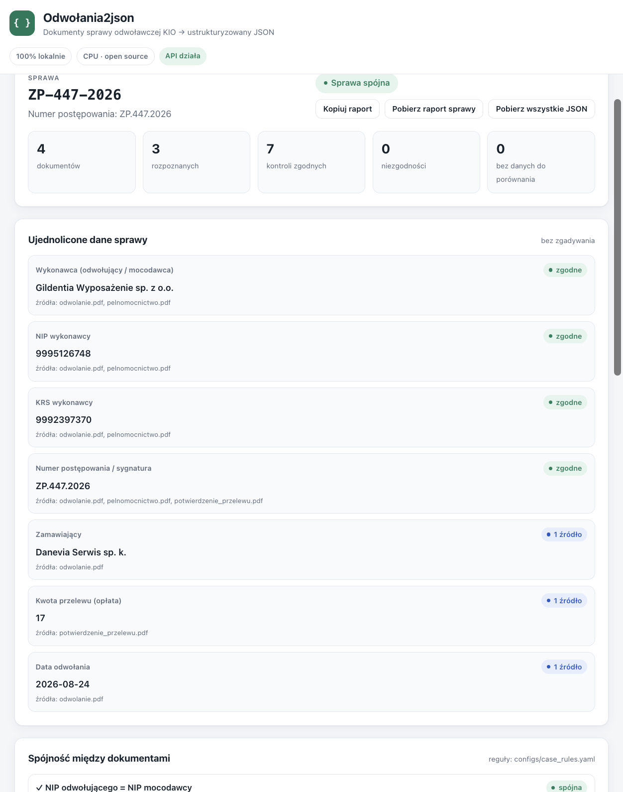
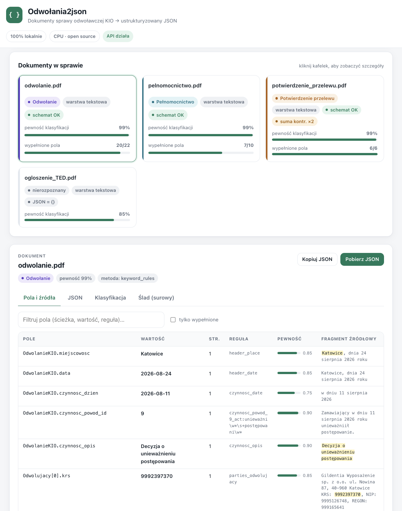

# Odwołania2json (jSON)

**Od dokumentów do danych.** Lokalny, open-source pipeline, który zamienia PDF-y ze spraw odwoławczych KIO w kanoniczny JSON gotowy dla systemów UZP — pojedynczo albo jako całą sprawę z kontrolą spójności między dokumentami.

HackNation 2026 · wyzwanie Urzędu Zamówień Publicznych · działa **w 100% on-premise na CPU** (bez GPU, bez płatnych API LLM, UI bez CDN).



## Start w 3 krokach (zwykły komputer, bez GPU, bez Tesseracta)

1. **Zainstaluj Pythona ≥ 3.11** (jeśli go nie masz): [python.org/downloads](https://www.python.org/downloads/) — na Windows zaznacz „Add Python to PATH”.
2. **Pobierz projekt i wejdź do katalogu:** `git clone … && cd jSON`
3. **Uruchom jedną komendą:**
   - macOS / Linux: `./run.sh`
   - Windows: dwuklik `run.bat` (albo `run.bat` w terminalu)

   Skrypt sam utworzy `.venv`, doinstaluje brakujące pakiety (tylko za pierwszym razem), sprawdzi środowisko (`doctor`) i otworzy przeglądarkę na `http://127.0.0.1:8000`. Nie masz PDF-ów? Kliknij **„Uruchom demo”** — fikcyjna sprawa z 3 dokumentów, opcjonalnie z symulowanym szumem OCR.

Brak Tesseracta **nie blokuje** aplikacji: PDF-y z warstwą tekstową (typowe dokumenty elektroniczne) działają w pełni, a UI i CLI pokazują czytelny komunikat, co zainstalować, żeby czytać też skany. Alternatywa z OCR „w pudełku”: `docker compose up --build web` ([sekcja 8](#8-instalacja)).

---

## Spis treści

0. [Co nowego w wersji 2.1](#co-nowego-w-wersji-21)
1. [Po co to jest](#1-po-co-to-jest)
2. [Co nowego w wersji 2](#2-co-nowego-w-wersji-2)
3. [Jak to działa (potok)](#3-jak-to-działa-potok)
4. [Sprawa wielodokumentowa i spójność](#4-sprawa-wielodokumentowa-i-spójność)
5. [Zasada „nie zgaduj przy braku danych”](#5-zasada-nie-zgaduj-przy-braku-danych)
6. [Odporność na OCR](#6-odporność-na-ocr)
7. [Co jest w repozytorium](#7-co-jest-w-repozytorium)
8. [Instalacja](#8-instalacja)
9. [Uruchomienie](#9-uruchomienie)
10. [Frontend (GUI)](#10-frontend-gui)
11. [Konfiguracja i rozszerzanie (YAML)](#11-konfiguracja-i-rozszerzanie-yaml)
12. [Transparentność](#12-transparentność)
13. [Ewaluacja: F1, szum OCR, testy](#13-ewaluacja-f1-szum-ocr-testy)
14. [Kontrakt JSON](#14-kontrakt-json)

---

## Co nowego w wersji 2.1

| Obszar | Zmiana |
|---|---|
| Uruchamianie | `run.sh` / `run.bat` (venv + zależności + diagnostyka + start), `Makefile`, `Dockerfile` + `docker-compose.yml` (CPU, Tesseract `pol` w obrazie), lżejsze `requirements.txt` (Streamlit i pytest w `requirements-dev.txt`), Python ≥ 3.11 |
| Diagnostyka | `odwolania2json doctor` / `./run.sh doctor`: Python, pakiety, konfiguracja YAML, model, Tesseract **i język `pol`** — z podpowiedzią, co zrobić; `/api/health` zwraca to samo dla UI |
| Bez Tesseracta | wykrywanie OCR (`ocr.ocr_status()`), fallback dla skanów (adnotacje / pola formularza PDF, plik `<nazwa>.ocr.txt` obok PDF), czytelne ostrzeżenia zamiast wyjątków; `pol` niedostępny → OCR w `eng` + słownik napraw |
| Tryb demo | `./run.sh demo [--noise 0.1]`, `GET /api/demo`, przycisk w UI — pełny potok na wbudowanej fikcyjnej sprawie, bez PDF-ów i OCR |
| NIP / IBAN | niezgodna suma kontrolna **nigdy nie usuwa wartości** — wartość zostaje w JSON, a w śladzie pojawia się `warnings[]` z `code: checksum_mismatch`; w UI badge „⚠ IBAN: suma kontrolna” na kafelku przelewu, w nagłówku dokumentu i przy polu |
| Błędy | uszkodzony / zaszyfrowany PDF nie zatrzymuje batcha (`{}` + opis w `.trace.json`); API zwraca zrozumiały komunikat (400/422), UI podpowiada, gdy serwer nie działa |
| Testy | 42 testy (nowe: brak OCR, skan bez tekstu, plik `.ocr.txt`, zaszyfrowany PDF, IBAN z błędną sumą zachowany, demo z szumem, `doctor`) |

F1 bez zmian: **0.9985** (te same 2044 TP), bo zmiany dotyczą uruchamiania, diagnostyki i ostrzeżeń, a nie reguł ekstrakcji.


---

## 1. Po co to jest

Sprawa odwoławcza to zwykle **kilka PDF-ów** (odwołanie, pełnomocnictwo, potwierdzenie przelewu, czasem dokumenty niezwiązane). Dane są rozproszone i zapisane różnie — dla człowieka czytelne, dla systemów nie.

```text
wiele PDF → tekst (+ OCR gdy trzeba) → typ dokumentu → pola → JSON kanoniczny
                                                          └→ sprawa: ujednolicenie + spójność
```

Zgodność z modelem: [hacknation-2026 / oczekiwane-json](https://github.com/Urzad-Zamowien-Publicznych/hacknation-2026/tree/main/oczekiwane-json).
Ocena organizatora: drzewo `input/caseN/*.pdf` → `output/caseN/<ta_sama_nazwa>.json`.
**Nazwa pliku nie jest używana do klasyfikacji** (tylko treść). Dokument spoza obsługiwanych klas → `{}`.

---

## 2. Co nowego w wersji 2

**Co zostało bez zmian:** cały potok (PyMuPDF → selektywny OCR → klasyfikacja reguły+TF‑IDF → silnik ekstrakcji YAML → szablon kanoniczny → JSON Schema → ślad), format wyjścia, CLI `process-input / process-file / eval`, endpoint `POST /api/extract`, konfiguracja typów w YAML.

**Co doszło / zmieniło się:**

| Obszar | Zmiana |
|---|---|
| Sprawa wielodokumentowa | `case.py` + `configs/case_rules.yaml`: wspólny identyfikator sprawy, lista dokumentów z typem i pewnością, **ujednolicone dane** (wykonawca, NIP, KRS, nr postępowania, kwota…) i **kontrole spójności** — CLI `process-case`, API `POST /api/case`, `--case-report` |
| Precyzja | powód czynności czytany ze zdania o czynności zamawiającego (reguły z priorytetami w YAML), nagłówek miejscowość/data tylko z pełnej linii, kwota tylko po etykiecie „kwota…”, tytuł przelewu z etykietami stopu, podpisujący z bloków podpisu (bez pełnomocników), konsorcja, JDG, wielu zamawiających |
| Nie zgaduj | usunięte zgadywanie „pierwsza data/rachunek w dokumencie”, próg `min_field_confidence` → `null` z zapisem w śladzie |
| OCR | słownik napraw `configs/ocr_lexicon.yaml`, kontekstowa naprawa cyfr/liter (NIP/KRS/REGON/PESEL, daty, rachunki), sumy kontrolne NIP/REGON/PESEL/IBAN jako informacja w śladzie |
| Ewaluacja | `eval-noise` (F1 przy syntetycznym szumie OCR), `synthetic.py`, 34 testy na syntetycznych tekstach |
| UI | nowy interfejs: wiele PDF naraz, widok sprawy, kafelki dokumentów z badge'ami typu i pewności, tabela pól (strona, reguła, pewność, fragment źródłowy), podgląd JSON z kopiowaniem i pobieraniem |

Wynik na zbiorze treningowym UZP (60 spraw + negatywy): **micro F1 0.850 → 0.9985** (szczegóły w [sekcji 13](#13-ewaluacja-f1-szum-ocr-testy)).

---

## 3. Jak to działa (potok)

```text
┌─────────────┐   ┌──────────────┐   ┌──────────────┐   ┌──────────────┐
│ 1. Ingest   │ → │ 2. Tekst PDF │ → │ 3. OCR?      │ → │ 4. Czyszczenie│
│ 1..N plików │   │  str. 1–3    │   │ tylko skan   │   │ OCR (YAML)   │
└─────────────┘   └──────────────┘   └──────────────┘   └──────┬───────┘
                                                               ▼
┌──────────────┐   ┌──────────────┐   ┌──────────────┐   ┌──────────────┐
│ 8. Sprawa    │ ← │ 7. Walidacja │ ← │ 6. Ekstrakcja│ ← │ 5. Klasyfik. │
│ spójność     │   │ schema+sumy  │   │ YAML + próg  │   │ typ / {}     │
└──────────────┘   └──────────────┘   └──────────────┘   └──────────────┘
```

| Etap | Co robi | Dlaczego |
|------|---------|----------|
| **Tekst** | `pymupdf`, strony 1–3 | kluczowe dane są na początku; szybko na CPU |
| **OCR** | Tesseract `pol` tylko dla stron z ubogą warstwą tekstu | pełny OCR każdej strony jest za wolny na CPU |
| **Czyszczenie OCR** | homoglify cyrylicy, słownik diakrytyków, cyfry/litery tylko w kontekście liczbowym | błędy OCR psują regexy i porównania |
| **Klasyfikacja** | słowa kluczowe + boosty strukturalne + kary za cechy negatywów, fallback TF‑IDF/LogReg | typ z treści, nie z nazwy; `unknown` → `{}` |
| **Ekstrakcja** | metody z `configs/extractors/*.yaml`, każda zwraca wartość + pewność + fragment | konfigurowalność i transparentność |
| **Próg pewności** | wartość poniżej `min_field_confidence` → `null` | „nie zgaduj”: lepszy brak niż zła wartość |
| **Build + walidacja** | szablon kanoniczny, JSON Schema, sumy kontrolne | stabilny kształt, sygnały jakości |
| **Sprawa** | ujednolicenie i kontrole z `case_rules.yaml` | weryfikacja krzyżowa dokumentów |

---

## 4. Sprawa wielodokumentowa i spójność

Wgraj jeden PDF albo kilka naraz (GUI, `process-case`, `POST /api/case`). Raport sprawy zawiera:

- `case_id` — podany przez użytkownika, nazwa katalogu sprawy albo numer postępowania (gdy dokumenty są zgodne); w ostateczności skrót z nazw plików,
- `documents[]` — każdy plik z typem, pewnością klasyfikacji, liczbą wypełnionych pól, informacją o OCR, walidacji i sumach kontrolnych **oraz pełnym JSON-em i śladem**,
- `unified` — jedna wartość na pole sprawy zebrana z kilku dokumentów:

| status | znaczenie | wartość |
|---|---|---|
| `agree` | dokumenty, które podają wartość, są zgodne | ustawiona |
| `single` | wartość tylko w jednym dokumencie | ustawiona, oznaczona jako niepotwierdzona |
| `conflict` | dokumenty się różnią | **`null`** + lista `candidates` |
| `missing` | żaden dokument nie podaje wartości | `null` |

- `consistency[]` — reguły krzyżowe, np. NIP/KRS/nazwa odwołującego = mocodawcy, pełnomocnik z odwołania jest w pełnomocnictwie, numer postępowania występuje w tytule przelewu, pełnomocnicy są wymienieni w tytule opłaty skarbowej. Wynik: `ok | partial | conflict | missing`. **Brak danych nigdy nie jest konfliktem.**
- `suggestions[]` — propozycje uzupełnień (np. KRS mocodawcy wzięty z odwołania). **Domyślnie nie są stosowane** (`fill_missing: false`): JSON dokumentu ma odzwierciedlać dokument, a dopisanie danych spoza niego to zgadywanie, które obniża precyzję.

Nazwy firm porównywane są po normalizacji (wielkość liter, interpunkcja, formy prawne: „spółka z ograniczoną odpowiedzialnością” = „sp. z o.o.”), osoby — po rdzeniach słów (tolerancja odmiany: „dla Anny Przykładowej” pasuje do „Anna Przykładowa”), identyfikatory — po cyfrach, kwoty — liczbowo.

Na 60 sprawach treningowych kontrole nie zgłaszają ani jednego fałszywego konfliktu; jedyne `missing` to brak KRS u osób fizycznych (poprawnie).

---

## 5. Zasada „nie zgaduj przy braku danych”

| Pole / sytuacja | Wcześniej | Teraz |
|---|---|---|
| Data przelewu bez etykiety | pierwsza data w dokumencie (np. „wygenerowano 01.07.2026”) | `null` |
| Rachunek, gdy role niejasne | pierwszy/drugi rachunek w tekście | tylko układ „dokładnie 2 rachunki”, inaczej `null` |
| Miejscowość/data odwołania | dowolne „Słowo, data” (np. „Zamawiający w dniu 20 marca…”) | tylko pełna linia nagłówka `Miejscowość, [dnia] DATA [r.]` |
| Kwota przelewu | — | tylko po etykiecie „kwota…/wartość”; opłata/prowizja i wpis od odwołania nigdy nie są kwotą przelewu |
| Powód czynności | najwyżej punktowane słowo w okolicy zarzutów | zdanie o czynności zamawiającego; zapasowe wzorce mają niższą pewność |
| Niska pewność | wartość w JSON | `null` w JSON, wartość + powód w śladzie (`suppressed`) |

Rozróżnianie podobnych pól odbywa się przez **kontekst etykiety** i kolejność etykiet w YAML (np. `data wykonania` przed `data zlecenia`; `kwota przelewu` zamiast dowolnej kwoty z PLN).

---

## 6. Odporność na OCR

Wszystko na CPU, bez modeli językowych:

- **homoglify** (cyrylica → łacina), NFC, twarde spacje,
- **słownik napraw** [`configs/ocr_lexicon.yaml`](configs/ocr_lexicon.yaml): `odwolujacy → odwołujący`, `pelnomocnictwo → pełnomocnictwo`… — tylko wpisane słowa, nie zgadujemy diakrytyków w nazwach własnych,
- **cyfry/litery w kontekście**: `O→0`, `l/I/|→1` wyłącznie po etykietach NIP/KRS/REGON/PESEL, w tokenach daty i w długich ciągach rachunków; kody typu `ZS.791.2026` nie są ruszane,
- **daty**: polskie miesiące, `DD.MM.RRRR`, `DD-MM-RRRR`, ISO, z zakłóceniami OCR,
- **sumy kontrolne** NIP/REGON/PESEL/IBAN trafiają do śladu (`checks` + czytelne `warnings`) i jako badge w UI — **nie odrzucamy** wartości przy złej sumie (dokument może zawierać literówkę, a JSON ma oddawać dokument; w danych syntetycznych UZP sumy często się nie zgadzają — na zbiorze treningowym to 189 ostrzeżeń przy niezmienionym F1).

Efekt na syntetycznym szumie (sekcja 13): przy 10% szumu F1 0.955 z czyszczeniem vs 0.896 bez.

### Gdy nie ma Tesseracta (albo języka `pol`)

| Sytuacja | Co się dzieje |
|---|---|
| PDF z warstwą tekstową | działa normalnie — OCR w ogóle nie jest potrzebny |
| Tesseract jest, ale bez `pol` | OCR w `eng`, słownik `ocr_lexicon.yaml` przywraca część diakrytyków; ostrzeżenie `ocr_lang_fallback` |
| skan, brak Tesseracta | tekst z adnotacji i pól formularza PDF (jeśli są); strona ma `method: no_text_ocr_unavailable`, ślad dostaje ostrzeżenie `ocr_unavailable` z podpowiedzią instalacji; brak tekstu → `{}` (nie zgadujemy) |
| skan + plik `<nazwa>.ocr.txt` obok PDF | użyty jako tekst (tryb demonstracyjny / OCR zrobiony gdzie indziej), ostrzeżenie `sidecar_text` |
| chcesz sprawdzić odporność bez skanów | `./run.sh demo --noise 0.2` albo `eval-noise` — symulowany szum OCR na CPU |

Stan OCR widać w UI (pigułka w nagłówku + baner), w `./run.sh doctor` i na początku każdego przetwarzania w CLI.

---

## 7. Co jest w repozytorium

```text
jSON/
├── configs/
│   ├── pipeline.yaml          ← strony, OCR, próg min_field_confidence
│   ├── document_types.yaml    ← rejestr typów + słowa kluczowe
│   ├── case_rules.yaml        ← NOWE: ujednolicenie i kontrole spójności sprawy
│   ├── ocr_lexicon.yaml       ← NOWE: naprawy diakrytyków i mylonych cyfr
│   ├── schemas/               ← JSON Schema wyjścia
│   └── extractors/            ← reguły pól per typ, czynnosc_powod.yaml, EXAMPLE_nowy_typ.yaml
├── src/odwolania2json/
│   ├── pipeline.py            ← process_pdf / process_text / process_input_tree
│   ├── case.py                ← sprawa wielodokumentowa
│   ├── synthetic.py           ← szum OCR + eval-noise
│   ├── doctor.py              ← 2.1: diagnostyka środowiska
│   ├── demo.py                ← 2.1: wbudowana sprawa demo
│   ├── pdf_text.py, ocr.py    ← tekst + selektywny OCR + wykrywanie Tesseracta i fallback
│   ├── normalize.py           ← normalizacja, naprawy OCR, sumy kontrolne
│   ├── classify.py            ← reguły + sklearn
│   ├── extract/engine.py      ← metody ekstrakcji wywoływane z YAML
│   ├── extract/patterns.py    ← wzorce PL (etykiety, daty, kwoty, bloki)
│   ├── build_json.py, validate.py, trace.py, evaluate.py, cli.py
├── app/api.py                 ← FastAPI: /api/extract, /api/case, /api/types, UI
├── app/streamlit_app.py       ← alternatywne GUI (też wiele plików)
├── frontend/                  ← nowe UI (HTML/CSS/JS, bez bundlera i CDN)
├── scripts/                   ← prepare_eval_split.py, train_classifier.py
├── models/doc_classifier.joblib
├── tests/                     ← 42 testy (syntetyczne teksty, bez danych treningowych)
├── run.sh / run.bat / Makefile← 2.1: jedna komenda do wszystkiego
├── Dockerfile, docker-compose.yml
└── start.sh / start.bat / start-web.sh   (zgodność wstecz → run.sh)
```

---

## 8. Instalacja

Najprościej: `./run.sh` / `run.bat` (patrz [Start w 3 krokach](#start-w-3-krokach-zwykły-komputer-bez-gpu-bez-tesseracta)). Wymagany tylko **Python ≥ 3.11**.

**OCR skanów (opcjonalnie):** `brew install tesseract tesseract-lang` (macOS) · `sudo apt install tesseract-ocr tesseract-ocr-pol` (Ubuntu) · [instalator UB-Mannheim](https://github.com/UB-Mannheim/tesseract/wiki) z językiem Polish (Windows). Potem `./run.sh doctor` powinien pokazać „OCR gotowy (… język pol)”.

**Docker (CPU, Tesseract `pol` w obrazie):**

```bash
docker compose up --build web                  # UI → http://127.0.0.1:8000
docker compose run --rm batch                  # input/ → output/
```

**Ręcznie:**

```bash
python3 -m venv .venv
source .venv/bin/activate          # Windows: .venv\Scripts\activate
pip install -r requirements.txt    # + requirements-dev.txt dla testów i Streamlit
pip install -e .
odwolania2json doctor
```

**Komendy `run.sh`** (to samo przez `make <cel>`):

| Komenda | Co robi |
|---|---|
| `./run.sh` / `make web` | UI na `127.0.0.1:8000` (`PORT=8010 ./run.sh` — inny port, `NO_BROWSER=1` — bez otwierania przeglądarki) |
| `./run.sh batch` | `input/**/*.pdf` → `output/**/*.json` |
| `./run.sh case input/case1` | raport jednej sprawy |
| `./run.sh demo --noise 0.1` | sprawa demo bez PDF/OCR |
| `./run.sh doctor` | diagnostyka |
| `./run.sh test` | pytest |
| `./run.sh eval` | batch + F1 + szum |

Typowe komunikaty: brak Pythona → link i komenda instalacji; brak sieci przy instalacji → „sprawdź połączenie i uruchom ponownie”; zajęty port → podpowiedź `PORT=…`; brak Tesseracta → ostrzeżenie (nie błąd) z komendą instalacji.

---

## 9. Uruchomienie

### A) Batch jak u organizatora

```bash
./start.sh
# albo
python -m odwolania2json process-input -i ./input -o ./output
```

`input/case1/odwolanie_nr_1.pdf` → `output/case1/odwolanie_nr_1.json` (+ `*.trace.json`, wyłączysz `--no-trace`).

Raporty spraw — **poza** `output/`, żeby drzewo oceniane przez organizatora zawierało tylko oczekiwane JSON-y:

```bash
python -m odwolania2json process-input -i ./input -o ./output --case-report ./reports
# → reports/case1.case.json
```

### B) Jedna sprawa z kilku PDF (CLI)

```bash
python -m odwolania2json process-case input/case1                  # cały katalog
python -m odwolania2json process-case a.pdf b.pdf c.pdf -o sprawa.json --case-id KIO-123
```

Przykładowe wyjście:

```text
Sprawa przyklad_42  status=ok  nr postępowania=MCLM/ZP/07/2026
  odwolanie.pdf                        odwolanie       pewność=0.99  pola=26/27
  pelnomocnictwo.pdf                   pelnomocnictwo  pewność=0.91  pola=7/10
  potwierdzenie_przelewu.pdf           przelew         pewność=0.99  pola=6/6
Spójność:
  ✔ NIP odwołującego = NIP mocodawcy                             ok        zgodne
  ✔ Numer postępowania występuje w tytule przelewu               ok        zgodne
  …
```

### C) Pojedynczy plik

```bash
python -m odwolania2json process-file dokument.pdf -o wynik.json --trace wynik.trace.json
```

### D) GUI

```bash
./run.sh                  # http://127.0.0.1:8000 (start-web.sh = to samo z auto-reload)
# alternatywnie (pip install -r requirements-dev.txt):
PYTHONPATH=src streamlit run app/streamlit_app.py
```

### Jak sprawdzić nowe funkcje na PDF-ach

1. `./run.sh`, otwórz `http://127.0.0.1:8000` (bez PDF-ów: przycisk **Uruchom demo**).
2. Przeciągnij **wszystkie PDF-y jednej sprawy** naraz (np. `input/przyklad_04/*.pdf` — zawiera też dokument spoza klas).
3. Sprawdź kartę sprawy (identyfikator, status), **ujednolicone dane** i **kontrole spójności**.
4. Kliknij kafelek dokumentu → zakładka **Pola i źródła**: strona, reguła, pewność i podświetlony fragment źródłowy dla każdego pola; nierozpoznany dokument ma `{}`.
5. Test „bez zgadywania”: wgraj tylko odwołanie i przelew → kontrole z pełnomocnictwem mają status „brak danych”, a nie „konflikt”; sprawa ma status „niekompletna”.
6. Pobierz JSON pojedynczego dokumentu albo raport całej sprawy.
7. Sumy kontrolne: w demo rachunek odbiorcy ma celowo błędną sumę IBAN — kafelek przelewu ma badge „⚠ IBAN: suma kontrolna ×1”, a wartość jest w JSON.

---

## 10. Frontend (GUI)



- upload: drag & drop lub wybór, jeden lub wiele PDF, lista plików do usunięcia, opcjonalny identyfikator sprawy,
- **karta sprawy**: identyfikator, numer postępowania, status (spójna / do sprawdzenia / konflikt / niekompletna), statystyki,
- **ujednolicone dane** jako kafelki z badge'ami `zgodne / 1 źródło / konflikt / brak danych` i źródłami,
- **spójność**: lista reguł ze statusem i wartościami; propozycje uzupełnień (bez automatycznego stosowania),
- **kafelki dokumentów**: kolor i badge typu, pasek pewności klasyfikacji, wypełnienie pól, OCR / warstwa tekstowa / „skan bez OCR”, walidacja schematu, **„⚠ NIP/IBAN: suma kontrolna ×N”**, liczba pól wyzerowanych progiem,
- **panel ostrzeżeń** sprawy i dokumentu (OCR, sumy kontrolne, błędy plików) — każde z wyjaśnieniem, że wartość nie została odrzucona,
- **baner stanu OCR** i pigułka „API działa · OCR pol ✓ / bez OCR” z komendą instalacji,
- **demo** z wyborem poziomu szumu OCR,
- **szczegóły dokumentu** w zakładkach: *Pola i źródła* (filtr, tylko wypełnione, badge „✓ NIP” / „⚠ IBAN: suma kontrolna” przy polu), *JSON* (podświetlanie, kopiuj, pobierz), *Klasyfikacja* (punktacja typów, strony i metoda tekstu), *Ślad (surowy)*.

| Metoda | Ścieżka | Opis |
|---|---|---|
| `GET` | `/` | UI |
| `GET` | `/api/health` | stan usługi + `ocr` (Tesseract, języki, `pol`) + `doctor` |
| `GET` | `/api/demo?noise=0.1` | raport sprawy demo (bez PDF) |
| `GET` | `/api/types` | typy dokumentów z YAML (etykiety w UI) |
| `POST` | `/api/extract` | jeden PDF → `{filename, document_type, result, trace}` |
| `POST` | `/api/case` | wiele PDF (`files`, opcjonalnie `case_id`) → raport sprawy |

---

## 11. Konfiguracja i rozszerzanie (YAML)

| Plik | Co konfiguruje |
|---|---|
| `pipeline.yaml` | `max_pages`, OCR, model, `min_field_confidence` |
| `document_types.yaml` | typy, słowa kluczowe, extractor, schema |
| `extractors/<typ>.yaml` | pola: `path`, `method`, `labels`, `stop_labels`, `normalize`, opcjonalnie `min_confidence` per pole |
| `extractors/czynnosc_powod.yaml` | powody 1–12: `act_patterns` + `priority` (zdanie o czynności), `patterns` (zapasowe) |
| `case_rules.yaml` | `unify` (pola sprawy i źródła), `rules` (kontrole: `equal_id`, `equal_name`, `equal_amount`, `contains`, `person_in`; `match: all/any`), `fill_missing` |
| `ocr_lexicon.yaml` | słowa do naprawy diakrytyków, mapowanie mylonych cyfr |

**Nowy typ dokumentu bez zmiany kodu:** skopiuj `extractors/EXAMPLE_nowy_typ.yaml`, dopisz typ w `document_types.yaml` (słowa kluczowe, extractor, schema), opcjonalnie dodaj schemat. Aby objąć go kontrolą sprawy — dopisz reguły w `case_rules.yaml` z `doc: <nowy_typ>`.

**Nowa kontrola spójności bez zmiany kodu** (przykład):

```yaml
rules:
  - id: zamawiajacy_w_pelnomocnictwie
    label: Zamawiający z odwołania występuje w pełnomocnictwie
    left:  {doc: odwolanie, path: "Zamawiajacy[*].nazwa"}
    right: {doc: pelnomocnictwo, path: "__text__"}
    compare: contains
    match: any
    severity: low
```

Ścieżki: `a.b[0].c`, `[*]` dla list, `__text__` (pełny tekst dokumentu), `__text_postepowanie__` (numer postępowania wyszukany w tekście).

---

## 12. Transparentność

Obok wyniku (`nazwa.json`) powstaje `nazwa.trace.json`:

- `classification`: typ, metoda, pewność, punktacja,
- `pages`: liczba znaków, metoda (`pdf_text`, `tesseract_ocr:pol`, `fallback_annotations`, `no_text_ocr_unavailable`, `sidecar_text`),
- `fields[]`: `path`, `value`, `page`, `rule_id`, `method`, `confidence`, `source_span`, ewentualnie `suppressed` (wartość odrzucona progiem i powód),
- `checks[]`: sumy kontrolne NIP/REGON/PESEL/IBAN (`checksum_ok`),
- `warnings[]`: czytelne ostrzeżenia `{code, severity, message, hint?, path?, value?}` — `checksum_mismatch`, `ocr_unavailable`, `ocr_lang_fallback`, `ocr_failed`, `sidecar_text`, `no_text`, `processing_error`, `demo`,
- `validation`: wynik JSON Schema.

Ślad nigdy nie trafia do ocenianego JSON-a. W GUI widać go w tabeli pól i w zakładce *Ślad*.

---

## 13. Ewaluacja: F1, szum OCR, testy

### F1 względem danych referencyjnych

```bash
python scripts/prepare_eval_split.py --dane ../hacknation-2026/dane --input ./input --gold ./gold --include-negatives
python -m odwolania2json process-input -i ./input -o ./output
python -m odwolania2json eval --pred ./output --gold ./gold --report ./output/f1_report.json
```

Porównanie po spłaszczonych ścieżkach z normalizacją wartości per pole; zła wartość liczy się jako FP+FN, a `null` jako FN (dlatego `null` jest tańszy niż zgadywanie).

| Typ | v1 | v2 |
|---|---|---|
| odwołanie | 0.90 | **0.998** |
| pełnomocnictwo | 0.68 | **1.000** |
| przelew | 0.88 | **0.997** |
| negatywy (`{}`) | 0.60 | **1.000** |
| **micro** | **0.850** | **0.9985** (P 0.999 · R 0.998) |

> Uwaga: reguły stroiliśmy na tych samych 60 sprawach, więc to wynik optymistyczny. Na nowych układach dokumentów spodziewaj się niższego F1. Strojenie odbywa się głównie w YAML (etykiety, stop-etykiety, wzorce czynności), więc nowy układ zwykle wymaga dopisania etykiety, a nie zmiany kodu.

### F1 przy syntetycznym szumie OCR

```bash
python -m odwolania2json eval-noise --rates 0,0.05,0.1,0.2
```

| szum | F1 (z czyszczeniem OCR) | F1 (bez czyszczenia) |
|---|---|---|
| 0 | 0.9985 | — |
| 0.05 | 0.977 | — |
| 0.10 | 0.955 | 0.896 |
| 0.20 | 0.917 | 0.799 |

Szum (`synthetic.corrupt_text`, deterministyczny z `--seed`): utrata diakrytyków, `0→O`, `1→l` w liczbach, homoglify cyrylicy, podwójne spacje.

### Testy

```bash
./run.sh test          # albo: python -m pytest -q
```

42 testy na fikcyjnych tekstach (bez danych treningowych): naprawy OCR i sumy kontrolne, zasada „nie zgaduj”, ekstrakcja z tekstu dla 3 typów, ślad, sprawa (zgodna / konflikt NIP / brak danych / brak dokumentu), odporność na szum, praca bez Tesseracta (skan → `{}` + ostrzeżenie, plik `.ocr.txt`), zaszyfrowany PDF, IBAN z błędną sumą zachowany w JSON, demo, `doctor`.

---

## 14. Kontrakt JSON

- **Odwołanie**: `OdwolanieKIO` (miejscowość, data, czynność, powód 1–12), `Odwolujacy[]` (+ pełnomocnik), `Zamawiajacy[]` (`prowadzacy_postepowanie` przy wielu zamawiających), `ZamowieniePubliczne`.
- **Pełnomocnictwo**: `mocodawca[]` (`data` + `podpisujacy[]`; konsorcjum = kilku mocodawców), `pelnomocnicy[]`.
- **Przelew**: `przelew_bankowy` (data, kwota, rachunki, numer transakcji, tytuł).
- **Negatyw / nieznany typ**: `{}`.

---

## Szybka ściąga

```bash
./run.sh                                                # instalacja + GUI → http://127.0.0.1:8000
./run.sh doctor                                         # co działa, czego brakuje (Tesseract/pol)
./run.sh demo --noise 0.1                               # demo bez PDF i OCR
./run.sh batch                                          # batch input/ → output/
docker compose up --build web                           # to samo z OCR w kontenerze
python -m odwolania2json process-case input/case1       # jedna sprawa + spójność
python -m odwolania2json eval --pred output --gold gold # F1
python -m odwolania2json eval-noise                     # F1 przy szumie OCR
python -m pytest -q                                     # testy
```

Wyłącznie komponenty open source: PyMuPDF, Tesseract, scikit-learn, FastAPI, Streamlit, jsonschema, OpenCV/Pillow, PyYAML, regex. · **Odwołania2json (jSON)** · HackNation 2026.
